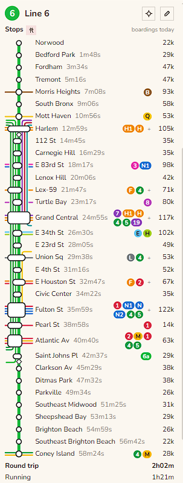
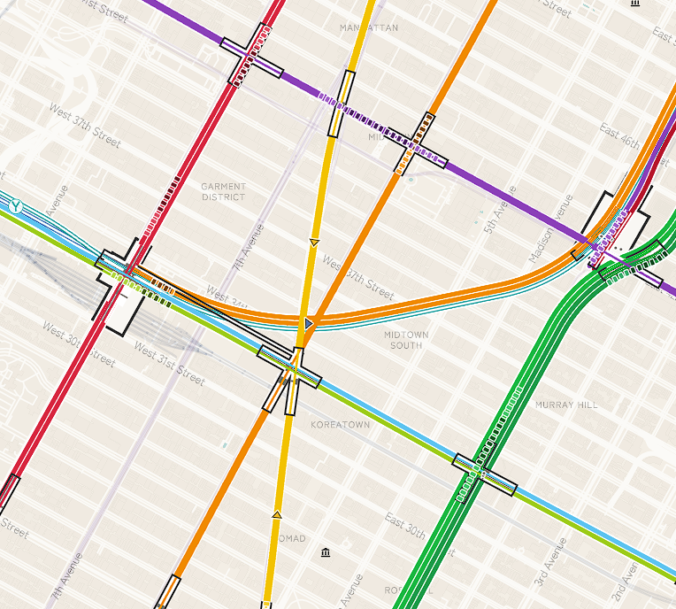
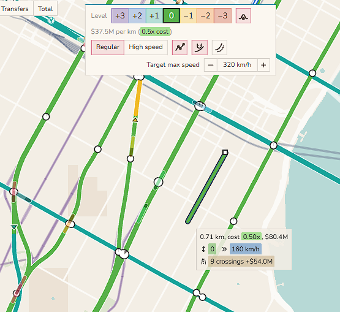
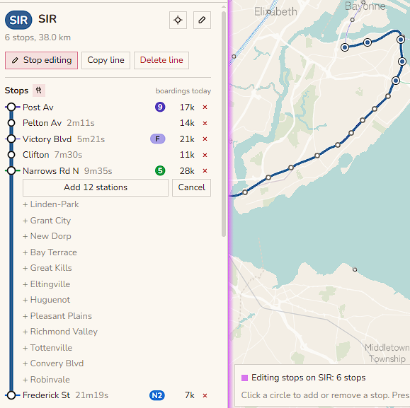
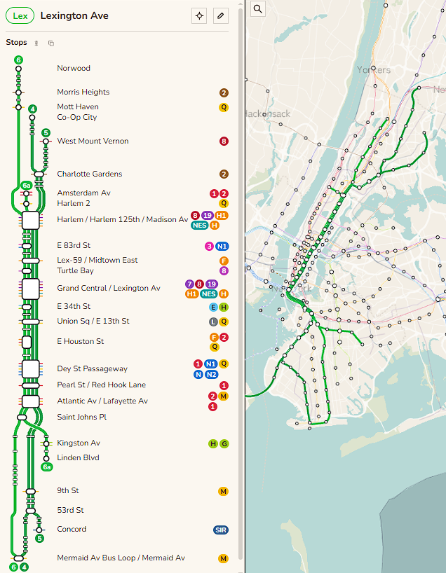
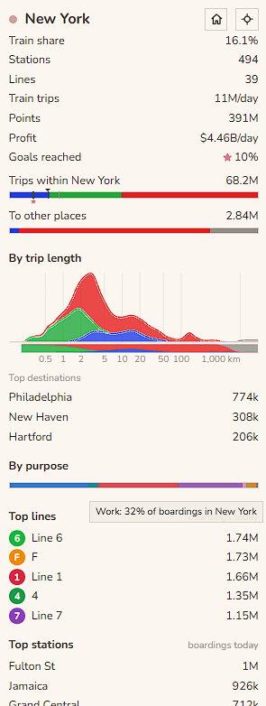
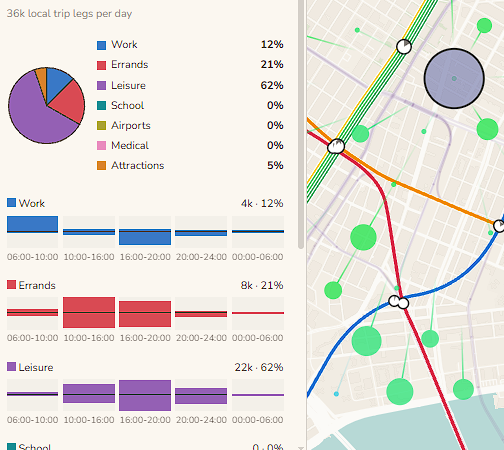
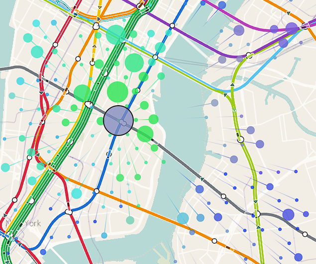
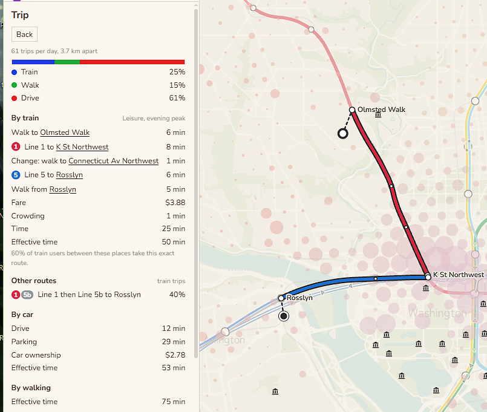

is a free browser game where you can build trains around the world!

<!-- {: .side .thin} -->
trains world offers
- diverse demand   
    - work, leisure, attractions, and other destination types
    - intercity demand fit on real world data
- realistic pathfinding
    - passengers consider many routes for crowding, price, and time
- optimization: smoothly handle **thousands** of stations and a global network

you can [try it here](/trainsworld/). 

<!-- {: .narrow} -->
below is some more information about trainsworld, for those who are curious.

[construction](#construction) · [scheduling](#scheduling) · [demand](#demand) · [pathfinding](#pathfinding) · [money](#money) · [sources](#sources)

### construction

building is easy in trainsworld!
{: .side}

track has one of 7 levels, ranging from -3 to +3. 

- track at grade (0) is cheap but cannot go over water, costs money at road crossings, and is expensive over steep terrain.
- viaducts (+1) can go over water and are somewhat cheap, but are expensive in steep terrain.
- tunnels (-2) are very expensive to maintain, but can travel under long distances of water and do not get more expensive in steep terrain.

track intersecting at the same level will cause delays. a ramp to change level is 200 meters long. when placing track, the game will try to *auto-ramp* to avoid same-level intersections. it will also auto-ramp over water, if needed. 

there is normal track and high speed track. there are also normal trains and high speed trains. any trains can run on any track, but you'll only get high speeds if you have high speed trains on high speed track. i might add maglev later.

#### snapping
two helpful construction features are *snap to real world network* and *snap beside track*. 

by snapping to real world network, you can place very long real world rail corridors very fast. you can cross france with one click. you can build the trans-siberian railroad with like ten clicks. 

with snap beside track, it's easy to create express routes. instead of a specific quad track feature, you can simply snap one pair of tracks next to another, automatically avoiding intersections, and then branch it off wherever needed. this lets you quickly double up a long route without needing to trace the entire route.

### scheduling
to add stops for a line, you can click a desired start point, end point, and then quick-fill all passed stations.

trains can be added to a line for one of three demand segments (times of day, low/med/high demand). or you can set certain target headways, for instance, saying that a line should have trains spaced apart every 4 minutes.

to create different running patterns, you can *copy line* and it'll put the new copied line into a *line group* with the reference line. you can see the entire line group's routing at once, and easily branch off lines at the ends, or short turn some lines to keep trains' average load even. pictured is my lexington avenue line group.

you can run express and local trains on the same double track, though it will cause heavy slowdowns, especially for frequent lines. you can add passing tracks at stations to partially alleviate this delay, letting trains pass each other without constructing a full line as quad track.

{: .half}
{: .half}

### demand
the trip demand model is the core of trainsworld. it is our estimate of what trips people want to take. the model is static, so the number of people that want to travel between two given places does not respond to constructed networks.
{: .side .small}
{: .side .below}

#### work
work commutes are the most common type of trip. we take the locations of jobs and homes, usually from national census data, and assign homes to jobs with a gravity model.

work trips are concentrated into the morning and evening rush hour.

#### leisure, errands
homes spawn leisure trips. some of these trips are assigned to nearby food and recreation jobs, weighted by how many jobs are in each spot. 

some leisure trips are social trips where people visit other peoples' homes. some go to parks. 

leisure trips are on average shorter than work trips, and happen more on weekends and evenings.

errand trips are assigned in a similar way to leisure, using different job sectors. errands are on average the shortest trips, representing people going to nearby stores and offices.

#### school, medical, airports, attractions
these trips come from specific published numbers, or are estimates from open data.

for schools, official enrollments where available, otherwise scale OSM schools by area they take up. similar for medical desitnations. 

for airports, official passenger counts. 

for attractions, we use wikidata visitor accouts where available, but also scale attraction demand for all attracitons in a city to try to get closer to what we'd expect from published city-wide visitor counts.

primary/secondary school trips are very short. university trips are somewhat short. airport trips are very long. 

some airport and attraction trips start from hotels rather than from homes.

#### weekends and holidays

people travel differently on different days. 

weekday mornings and afternoons are dominated by work trips, while weekends and holidays are dominated by leisure and errands. 

one-day holidays mostly behave like weekends, with less travel overall, with social leisure travel relatievly more important. for large multi-day holidays, like the Chinese Golden Week, intercity travel spikes at the beginning and end, but falls a lot in cities in the middle of the holiday.

### pathfinding

people can take the train, walk, or "drive" (car/moped/bike).

{: .side}

a person will consider the effective time for each for these modes, and pick one of the best ones. passengers switch their choice with a soft threshold, so if a train takes 50% longer than a car on a certain route, it might still get 20% of the passengers on that route, as opposed to 0%. this models personal preference, among other things. the threshold is less soft when choosing between two different train routes, where people will mostly just take the fastest, least crowded, cheapest route.

each person has a money per time value. a person's value of time varies, and depends in part on the average income in the country.
{: .side}

the "drive" cost counts the time to drive, the time to park at the destination (which is often very high for urban centers), and the cost of car ownership.

the train cost counts the walks to and from the stations, the total fare including any transfers, train crowding, and any waiting they have to do for the train (up to a cap, after which we assume the person will check the timetable and arrive shortly before the train)

crowded trains at >70% of capacity will feel like a slowdown, which causes passengers to distribute along parallel routes even if one is slightly faster. 

people can also "drive" to train stations, then park and ride. but they are still charged for car ownership and parking, and there is a fixed penalty for parking and riding, so this mode is usually not common.

#### intercity travel
in addition to train, walk, and drive, people can also take the plane. plane mostly starts being used over driving at around ~500km. its cost depends on travel time to an airport, time spent waiting at the airport, and the fare.

### money 
this game is easier than real life. when trainsworld costs are compared to a cheap metro / rail country, like Spain,

- construction costs about equal 
- track and station maintenance is about equal (Spain is known for probably not spending enough on maintenance)
- train running costs about 0.7x as much

also, money runs at 100x speed. in one in game day, you make what you would make in 100 days.

### acknowledgement

trains world is inspired by games like [nimby rails](https://store.steampowered.com/app/1134710/NIMBY_Rails/) and [subway builder](https://www.subwaybuilder.com/). 

this game is made by claudes and anita.

### sources

Map data © OpenStreetMap contributors, under the Open Database License.

Basemap © OpenMapTiles, served by OpenFreeMap. Rail lines from OpenStreetMap and national rail registers.

© EuroGeographics for the administrative boundaries.

Population and built-up areas from GHSL, © European Union 1995-2025, and Kontur Population (CC BY 4.0).

Boundaries from geoBoundaries (Spain's from the Instituto Geográfico Nacional, CC BY 4.0), Natural Earth and the Office for National Statistics. Contains OS data © Crown copyright and database right 2025.

Contains public sector information licensed under the Open Government Licence v3.0 (ONS, Nomis, Department for Education, National Records of Scotland, NISRA) and the Open Government Licence (Ontario).

Powered by TfL Open Data. Contains Network Rail Infrastructure Limited data, used under the Open Government Licence v3.0.

Adapted from Statistics Canada, 2021 Census. This does not constitute an endorsement by Statistics Canada of this product.

Australian Bureau of Statistics, 2021 Census and statistical areas (CC BY 4.0).

US Census Bureau, NCES, FAA and the Bureau of Transportation Statistics.

New York subway, LIRR and Metro-North timetables from MTA open data, and PATH timetables from the Port Authority of New York and New Jersey. The game is not affiliated with or endorsed by the MTA or the Port Authority.

Paris timetables © Île-de-France Mobilités, under the Open Database License.

China township populations from the ASPECT population grid (Ju et al. 2025, Scientific Data), CC BY 4.0.

INSEE and geo.api.gouv.fr (Licence Ouverte 2.0). © Statistisches Bundesamt (Destatis), Zensus 2022. © BKG 2025, dl-de/by-2-0. Pendleratlas of the statistical offices of the Federation and the Länder.

Processed from Japan's 2020 census and 2021 economic census (Statistics Bureau of Japan, e-Stat) and National Land Numerical Information (MLIT).

IBGE. Metrô de São Paulo origin and destination survey 2017. Ministry of the Interior and Safety (Korea). Census of India 2011. Shanghai Municipal Statistics Bureau.

World Bank (CC BY 4.0), Maddison Project Database 2023 (CC BY 4.0), Eurostat, Wikidata and OurAirports.

Large lakes from Natural Earth. Terrain classes from GEDTM30 (OpenGeoHub, CC BY 4.0). Hill shading from Terrain Tiles on AWS Open Data.

Fonts Zen Maru Gothic, Noto Sans and Nunito, under the SIL Open Font License 1.1.

Finger snap recording by freesound_community, cork pop by Universfield, wood knock by rohhsadotcom and magazine insert by freesounds-4u, all from Pixabay.

All data was adapted for this game.

The game's data files are under the Open Database License (ODbL), as the OpenStreetMap data they come from is.
